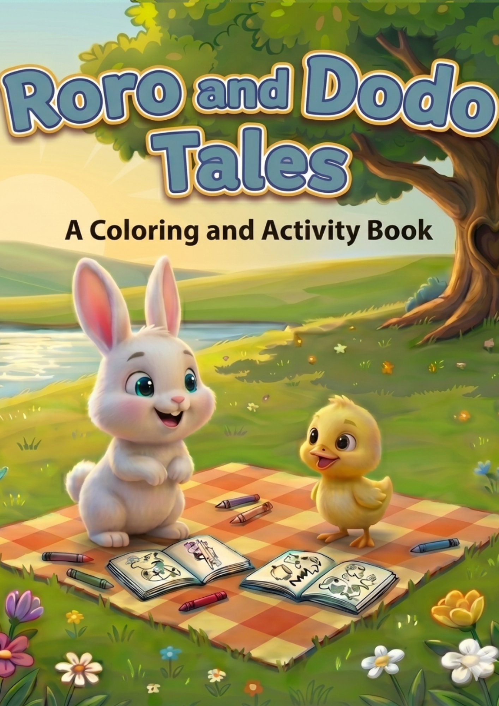

# Visionary Prints — Official Digital Agency & Publishing House

A modern, high-converting single-page agency website for **Visionary Prints**, built with **Next.js 16 (App Router)**, **React 19**, and **Tailwind CSS**.



## 🌟 Overview & Key Sections

1. **Hero Section**:
   - Modern, bold headline introducing **Visionary Prints** as a premier digital agency specializing in web development, digital publishing, and media creation.
   - High-contrast subheadline with dual call-to-actions: **"View Our Work"** and **"Work With Us"**.
   - Agency metric badges, ambient glow backdrops, and interactive micro-pills.

2. **Services Grid**:
   - Visually engaging grid featuring four core disciplines with custom icons, feature deliverables, and glow hover cards:
     - 💻 **Web Development**: Custom Next.js & React web applications, high performance, headless integrations, and mobile responsiveness.
     - 📚 **Digital Publishing**: Full-lifecycle Amazon KDP publishing, book formatting (paperback & eBook), cover design, and global distribution.
     - 🎬 **Short-Form Video Editing**: Viral TikTok, Instagram Reels, and YouTube Shorts editing with dynamic pacing, kinetic captions, and sound design.
     - ✨ **Content Creation**: Omni-channel brand storytelling, sales copy, lead magnets, and conversion-focused assets.

3. **Amazon KDP Publications (Featured Work)**:
   - Dedicated prominent showcase for physical and digital books published worldwide on Amazon KDP:
     - **"Roro and Dodo Tales"**: A children's coloring and activity book featuring character stories, sensory coloring sheets, and cognitive mazes.
     - **"EYE BIBLE"**: An inspirational visual scripture and brain activity book combining sacred scripture with intricate puzzles and observation challenges.
     - Each card features book cover artwork, rating badge, specification tags, feature list, and a prominent **"Buy on Amazon"** button (ready for slotting live Amazon listing URLs).

4. **Agency Advantage ("Why Visionary Prints")**:
   - 4-step execution framework: Strategic Blueprint → Engineering & Craftsmanship → Amazon & Web Deployment → Optimization & Scaling.
   - Quality guarantee and competitive agency advantages.

5. **Interactive Contact & Project Inquiries**:
   - High-conversion inquiry form (Name, Email, Service Needed, Estimated Budget, Message).
   - Direct email contact card with one-click clipboard copy (`visionarysites@gmail.com`).
   - Location notice (`Lagos, Nigeria • Global Operations`) and 24-hour response guarantee.

6. **Footer**:
   - Social media links (X / Twitter, Instagram, LinkedIn, GitHub, YouTube).
   - Direct email address, navigation links, and copyright notice (`© 2026 Visionary Prints. All rights reserved.`).

---

## 🚀 Tech Stack

- **Framework**: [Next.js 16 (App Router)](https://nextjs.org/)
- **Library**: [React 19](https://react.dev/)
- **Styling**: [Tailwind CSS v4](https://tailwindcss.com/)
- **Icons**: [Lucide React](https://lucide.dev/) & Custom SVG Brand Icons
- **Fonts**: [Google Fonts (Inter & Outfit)](https://fonts.google.com/)
- **Deployment**: [Vercel](https://vercel.com/)

---

## 🛠️ Local Development

1. **Clone the repository**:
   ```bash
   git clone https://github.com/ademikelz19-hub/visionaryprints.git
   cd visionaryprints
   ```

2. **Install dependencies**:
   ```bash
   npm install
   ```

3. **Run the development server**:
   ```bash
   npm run dev
   ```

4. **Open in browser**:
   Navigate to [http://localhost:3000](http://localhost:3000)

5. **Build for production**:
   ```bash
   npm run build
   ```

---

## 🌐 Deploy to Vercel

1. Push your changes to GitHub (already synced to `ademikelz19-hub/visionaryprints`).
2. Visit [Vercel](https://vercel.com/new).
3. Import the `visionaryprints` repository.
4. Keep standard settings (Next.js preset) and click **Deploy**.
5. Your live agency website will be deployed in seconds.

---

## 📄 License & Attribution

Designed and engineered for **Visionary Prints**. All rights reserved.
